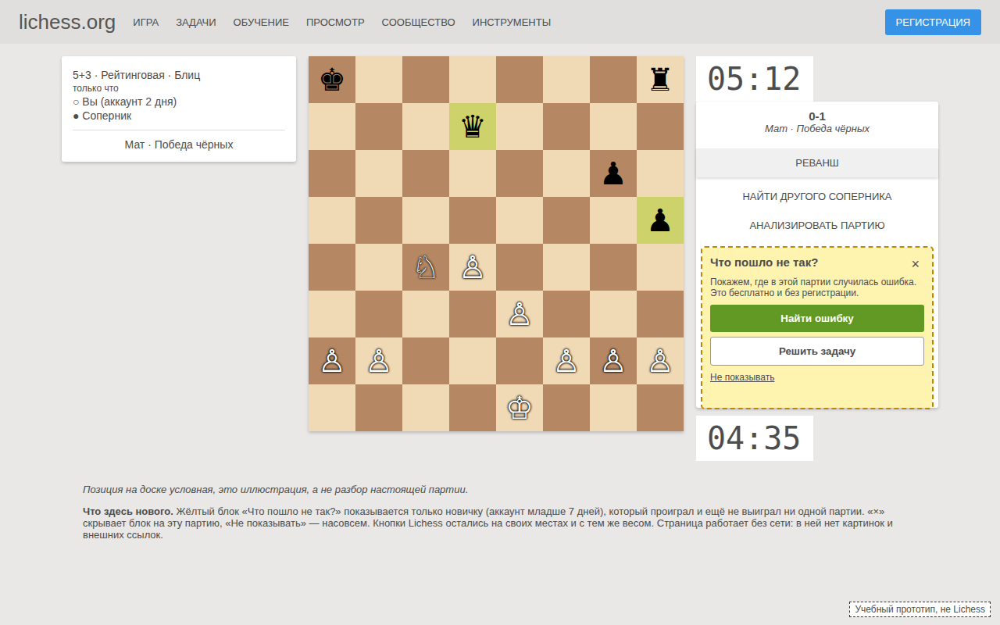

# Удержание новичков на шахматном сайте

Продуктовый кейс: от вопроса «почему новички не остаются» до конкретного решения с расчётом бюджета, метриками и планом проверки. Шахматный сайт в духе Lichess (бесплатный, без рекламы и платных функций) вырос до рекордной аудитории, но новички регистрируются, играют пару партий и пропадают.

Данные сгенерированы для учебного кейса и не имеют отношения к реальной статистике Lichess. С самим Lichess проект не связан.

## Коротко

| | |
|---|---|
| Вопрос | Рекордная аудитория это рост или иллюзия, где и почему уходят новички, что менять первым |
| Данные | 24 907 пользователей, 207 640 записей об активности за 90 дней (1 июля – 28 сентября 2026), когортный отчёт |
| Проблема | Из новичков июля в августе вернулись 30,5%, из новичков августа в сентябре 14,7%. Не хватает 2002 человек |
| Главная находка | Новички, не выигравшие в день регистрации ни одной партии, за неделю возвращаются в 25,7% случаев, остальные в 60,2% |
| Решение | Блок «Что пошло не так?» на экране после поражения для новичков без побед |
| Цена | 15 человеко-дней и 232 000 ₽ из квартального лимита 600 000 ₽ |
| Как проверим | Эксперимент с контрольной группой, цель +8 пунктов к доле вернувшихся за неделю, критерий ошибки записан заранее |
| Стек | SQL (SQLite), Python 3, matplotlib, HTML/CSS/JS, Markdown |

Если времени мало, достаточно прочитать [analysis/05_solution.md](analysis/05_solution.md) (итоговое решение) и открыть [design/prototype/index.html](design/prototype/index.html) (прототип).

## Контекст и ограничения кейса

Задача поставлена так: выбрать одно изменение для новичков, которое должно уложиться в ограничения квартала и не нарушать принципы сайта.

**Бюджет.** Деньги, сроки и ставки не мои, они заданы условиями учебного кейса, я только считала решение в их рамках:

| Ограничение | Значение |
|---|---|
| Бюджет на квартал | 600 000 ₽ |
| Дни разработки (фронтенд + бэкенд) | не более 20 |
| Срок до запуска | 6 недель |
| Ставка за человеко-день | дизайнер 16 000 ₽, фронтенд 20 000 ₽, бэкенд 24 000 ₽, аналитик 16 000 ₽, модератор 6 000 ₽, переводчики-волонтёры 0 ₽ |
| Типовые трудозатраты | в условиях заданы ориентиры: например, «новый блок на готовом экране», «показать изменение части новичков и сравнить с остальными» |

Из ориентиров и ставок я собрала смету каждого варианта решения (см. раздел «Сколько стоит»). Влияние решения на метрики (параметр impact в RICE) в условиях не дано, это моя оценка.

**Принципы сайта.** Lichess — бесплатный шахматный сервер с открытым кодом, работает с 2010 года, им управляет некоммерческая организация. Он живёт на пожертвования, не показывает рекламу и не продаёт данные пользователей. Регулярные жертвователи получают только значок рядом с именем, без дополнительных функций. Из этого в кейсе выведены принципы, которым должно соответствовать любое предложение:

| Принцип | Что значит для решения | Как это соблюдено в блоке «Что пошло не так?» |
|---|---|---|
| Бесплатно для всех | Ничего нельзя получить за деньги, новичок и жертвователь видят одно и то же | Блок одинаков для всех новичков, ничего не продаёт и не подталкивает к платному |
| Без рекламы и слежки | Нет сторонних счётчиков, данных собирается ровно столько, сколько нужно для игры | Новых данных не собирается, кроме группы эксперимента на сервере, третьим лицам они не передаются |
| Честно | Нет давления, ложной срочности, скрытых отказов и обмана в игре | Нейтральный вопрос вместо «сдаёшься?», нет таймеров, серий, штрафов и уведомлений; «Реванш» и «Найти другого соперника» остаются на месте с прежним весом |
| Открыто | Решение можно показать сообществу и объяснить | Блок объясняется одной фразой («после поражения предлагаем разобрать партию или решить задачу») и опирается на уже существующие функции сайта: анализ партии и задачи |
| Уважение ко времени | Сайт помогает играть и учиться, а не удерживает любой ценой | Закрыть блок («×») и отключить его насовсем («Не показывать») можно одним кликом, блок предлагает, а не заставляет |

Кейс прямо запрещает шесть вещей, и любое решение с хотя бы одной из них не принимается:

1. Деньги за доступ: реклама, платные функции, «премиум», особые возможности за пожертвование.
2. Лишние данные: сбор сверх нужного для игры, сторонние счётчики и трекеры, передача данных кому-либо.
3. Давление: ложная срочность, серии дней, которые «сгорают», штрафы за то, что человек не зашёл, стыд («сдаёшься?»).
4. Навязчивость: уведомления и письма без явного согласия, заранее включённые галочки.
5. Трудный отказ: закрыть, пропустить или отключить должно быть так же просто, как согласиться.
6. Обман в игре: боты под видом людей, подбор слабых соперников без ведома игрока, «подаренные» победы и рейтинг.

Предлагать сыграть с компьютером, решить задачу или пройти урок можно: это честно, если человек видит предложение и может отказаться.

В таблице RICE у каждой гипотезы есть столбец «принципы»: «да» значит, что гипотеза принципам не противоречит, «риск» значит, что нужна оговорка. У H3 это яркий блок на главной, который должен скрываться для опытных игроков. У H4 это подбор соперников: нельзя сводить новичка со слабыми соперниками без его ведома.

## Данные

| Таблица | Источник | Что в ней |
|---|---|---|
| `users` | `data/users.csv` | 24 907 пользователей: `user_id`, `signup_date`. 4000 из них зарегистрировались до 1 июля, 20 907 с 1 июля |
| `activity` | `data/activity.csv` | 207 640 строк. Одна строка = один человек в один день, когда он заходил: `user_id`, `date`, `games`, `wins`, `puzzles`, `lessons` (партии, победы, решённые задачи, пройденные уроки). Если человека в этот день нет в таблице, он не заходил |
| `cohorts` | `data/cohort_report.csv` | Готовый когортный отчёт: когорта (дата регистрации) и столбцы `d0` … `d30` |
| `act` | собирается в `src/db.py` | `activity` плюс день регистрации, номер дня с регистрации (`day_n`), неделя (`week`) и месяц (`month`) |
| `newcomers` | собирается в `src/db.py` | Новички (зарегистрировались с 1 июля), по строке на человека, с полями для анализа удержания (описаны ниже) |
| `rice` | `analysis/rice.csv` | Моя таблица оценок гипотез |

Новичком я считаю того, кто зарегистрировался 1 июля или позже: только за ним видно всю историю с первого дня. Все 20 907 новичков заходили в день регистрации.

Что я проверила в данных до выводов: выгрузка заканчивается 28 сентября (сентябрь неполный, 28 дней из 30), неделя с 29 июня содержит всего 5 дней, неделя с 28 сентября один день. Поэтому ни неполные недели, ни неполные месяцы я не сравниваю с полными напрямую.

## Метрики и формулы

Все метрики посчитаны SQL-запросами, которые лежат в `analysis/*.md` под каждым выводом.

### Активность и липкость (`01_activity_and_stickiness.md`)

| Метрика | Что показывает | Формула |
|---|---|---|
| DAU | Сколько разных людей заходили в этот день | `COUNT(DISTINCT user_id)` за день |
| WAU | То же за неделю (с понедельника) | `COUNT(DISTINCT user_id)` за неделю. Неделя полная, если в выгрузке все 7 дней |
| MAU | То же за календарный месяц. Человек считается один раз, сколько бы дней он ни заходил | `COUNT(DISTINCT user_id)` за месяц |
| Средний DAU месяца | Типичная дневная аудитория | `COUNT(*) / COUNT(DISTINCT date)` по месяцу (одна строка `activity` = один человек-день) |
| Липкость | Какую долю дней месяца в среднем бывает на сайте человек из месячной аудитории | `средний DAU / MAU × 100%` |

Пример. Июль: средний DAU 1617,7, MAU 7917, липкость 1617,7 / 7917 = 20,4%. Август: 2644,6 / 17 805 = 14,9%. MAU вырос в 2,2 раза, а липкость упала, значит, пришло много людей, которые заходят редко.

Почему рекордный MAU не доказывает рост: он считает человека один раз, вернётся он или нет. Люди, которые пришли и не остались, выглядят в нём как успех.

### Удержание новичков

| Метрика | Что показывает | Формула |
|---|---|---|
| Удержание дня N (когортное) | Какая доля когорты зашла ровно на N-й день после регистрации | `dN / d0 × 100%`, где `d0` размер когорты, `dN` сколько человек из неё заходили в день N. Пустая ячейка значит, что день ещё не наступил, это не ноль |
| `back_d1`, `back_d7` | Вернулся ли конкретный новичок на следующий день / ровно на 7-й | 1 или 0 в таблице `newcomers` |
| `back_w1` | Вернулся ли хотя бы раз за первую неделю (дни с 1-го по 7-й) | 1 или 0; доля = `AVG(back_w1) × 100` |
| `full_week` | Прошла ли у новичка вся неделя в пределах выгрузки | 1 или 0; доли `back_w1` считаются только по `full_week = 1`, иначе у новичков последних дней она занижена |
| `games0`, `wins0`, `puzzles0`, `lessons0` | Что новичок сделал в день регистрации: партии, победы, задачи, уроки | числа в `newcomers` |

Пример удержания дня N: когорта 2026-08-08 (1624 человека), день 1: 351 / 1624 = 21,6%. В штуках это самая большая когорта, а в процентах одна из худших (обычные когорты июля дают около 42% в день 1).

**Главная метрика эксперимента.** Доля вернувшихся за первую неделю среди новичков без побед в день регистрации:

```sql
SELECT AVG(back_w1) * 100 FROM newcomers
WHERE wins0 = 0 AND full_week = 1;   -- сентябрь: 34,4% (940 человек)
```

**Ограничитель** (то, что не должно ухудшиться): среднее число партий в день регистрации, `AVG(games0)` у новичков без побед. Сейчас 2,07. Если блок отобьёт желание играть, это будет видно здесь.

### Приоритизация RICE (`04_prioritization.md`)

```
RICE = охват × влияние × уверенность / 100 / трудозатраты
```

| Параметр | Что это | Как я получала |
|---|---|---|
| Охват | Сколько новичков в месяц затронет проблема | Считается по данным за сентябрь 2026: самый свежий и самый обычный месяц, без наплыва, как в августе. Брала тех, у кого есть сама проблема, а не всех, кто увидит изменение |
| Влияние | Как сильно решение изменит поведение одного затронутого человека (в таблице значения 0,5 / 1 / 2) | Моя оценка по размеру разрыва в данных. Для H1 разрыв 34,5 пункта, поэтому 2 |
| Уверенность, % | Насколько я верю в причину | 80: связь видна, но причинность не доказана. 50: данные не позволяют проверить гипотезу. 100 не поставила никому: ничего не проверено экспериментом |
| Трудозатраты | Человеко-дни всех ролей | Смета, см. «Сколько стоит» |

Пример для H1: `1157 × 2 × 80 / 100 / 15 = 123`.

### Размер выборки для эксперимента

Сколько новичков нужно в каждой группе, чтобы заметить разницу в `Δ` пунктов при доле `p`:

```
n = 2 × 7,84 × p × (1 − p) / Δ²
```

7,84 это (1,96 + 0,84)²: уровень значимости 5% и мощность 80%. Для `p = 0,344` и `Δ = 0,08` получается 553 человека в группе. Новичков без побед около 1157 в месяц, то есть по 578 в группе, одного месяца хватает. Для разницы в 5 пунктов нужно по 1415 человек, это около 10 недель, в срок не помещается. Поэтому цель 8 пунктов (около четверти разрыва в 34,5 пункта между невыигравшими и выигравшими).

## Ход анализа

Каждый шаг это отдельный файл в `analysis/`: вопрос, запросы и вывод в одном месте.

| Шаг | Файл | Вопрос | Результат |
|---|---|---|---|
| 1 | [`01_activity_and_stickiness.md`](analysis/01_activity_and_stickiness.md) | Рекорд аудитории это рост или проблема | Проблема: из новичков июля в августе вернулись 30,5% (1219 из 4003), из новичков августа в сентябре 14,7% (1864 из 12 675). Если бы августовские вернулись как июльские, было бы 12 675 × 30,5% = 3866, не хватает 3866 − 1864 = 2002 человека |
| 2 | [`02_cohort_report.md`](analysis/02_cohort_report.md) | Что странного в когортном отчёте и чем это проверить | Два наплыва регистраций (7–13 и 28–31 августа, 6778 и 2301 человек), удержание дня 1 около 20% против 42% у обычных когорт. И провал 19 августа: 935 заходов при примерно 2500 в соседние дни, затронуты все пользователи |
| 3 | [`03_hypotheses.md`](analysis/03_hypotheses.md) | Почему уходят: путь новичка, сигналы, пять гипотез | H1 и H3 не опровергнуты, но есть другое объяснение. H2 и H4 нельзя проверить этими данными. H5 опровергнута |
| 4 | [`04_prioritization.md`](analysis/04_prioritization.md) | С чего начать | RICE: H1 123, H3 71, H4 64, H2 18. H4 не помещается в бюджет |
| 5 | [`05_solution.md`](analysis/05_solution.md) | Что именно делаем, сколько стоит, как проверим, когда признаем ошибку | Блок на экране после поражения, 232 000 ₽, эксперимент |

### Гипотезы и вердикты

| Гипотеза | Суть | Что нашла | Вердикт |
|---|---|---|---|
| H1. После поражения тупик | После проигрыша экран предлагает только сыграть ещё | Без побед в день регистрации вернулись 25,7% (7781 человек), с победой 60,2% (12 196). Разрыв 34,5 пункта, ступенчатый: у выигравших доля почти не зависит от числа побед | Не опровергнута, но есть другое объяснение: слабые игроки и проигрывают, и уходят |
| H2. Быстрая игра слишком быстрая | Новички выбирают пулю и вылетают по времени | В данных нет контроля времени и способа окончания партии | Проверить нельзя |
| H3. Обучение спрятано | Задачи и уроки доступны только из верхнего меню | Не делали ни задач, ни уроков 71,0% новичков. Из делавших вернулись 59,8%, из остальных 41,6% | Не опровергнута, но есть самоотбор: заинтересованный и пробует всё, и возвращается |
| H4. Стартовый рейтинг слишком высокий | Рейтинг 1500 сводит новичка с сильными соперниками | В данных нет рейтингов. Косвенно: новички выигрывают лишь 42,6–45,1% партий | Проверить нельзя |
| H5. «Одной партии мало» (моя) | Сыгравшие одну партию возвращаются реже | При одинаковом результате разница почти исчезает (24,6% против 26,5% у проигравших) | Опровергнута: решает результат, а не число партий |

**Проверка H1 на честность.** Общий разрыв мог получиться из-за наплывов: в наплыв пришло больше невыигравших и у всех ниже возвращаемость. Поэтому я повторила проверку внутри каждого из пяти периодов. Разрыв остался в каждом, от 24,6 до 34,1 пункта. Но это не отменяет другого объяснения, причинность без эксперимента не доказать.

## Решение

На экране после партии новичку (аккаунт младше 7 дней), который проиграл и ещё ни разу не выиграл, под кнопками «Реванш», «Найти другого соперника», «Анализировать партию» появляется блок «Что пошло не так?» с двумя действиями:

- «Найти ошибку» запускает анализ этой партии и открывает режим «Учись на своих ошибках», который на Lichess уже есть;
- «Решить задачу» открывает готовую задачу из раздела «Задачи».

Блок можно закрыть для этой партии («×») или отключить насовсем («Не показывать»). Опытные игроки и выигравшие его не видят. Новых экранов нет, ничего из старого не убрано, «Реванш» остаётся главной кнопкой. Новых данных не собирается: нужны только дата регистрации и результаты партий, они у сайта уже есть.



Каркас «было / стало»: [design/wireframe.html](design/wireframe.html). Прототип: [design/prototype/index.html](design/prototype/index.html), заметки к нему: [design/prototype_notes.md](design/prototype_notes.md).

Охват: 1157 новичков в месяц (около 41 в день) заканчивают день регистрации без побед. Это нижняя граница: блок увидят и те, кто проиграл первую партию, а потом выиграл (проиграли хотя бы одну 3624 человека), но порядка партий в данных нет и точно посчитать их нельзя.

### Сколько стоит

Смета H1 (ставки и ориентиры по трудозатратам из условий кейса):

| Роль | Что делает | Человеко-дни | Ставка | Сумма |
|---|---|---|---|---|
| Дизайнер | Блок на готовом экране | 2 | 16 000 ₽ | 32 000 ₽ |
| Фронтенд | Блок (3) и эксперимент (1) | 4 | 20 000 ₽ | 80 000 ₽ |
| Бэкенд | Разделение новичков на две группы | 2 | 24 000 ₽ | 48 000 ₽ |
| Аналитик | Замеры эксперимента | 3 | 16 000 ₽ | 48 000 ₽ |
| Модератор | 1 день в неделю, 4 недели после запуска | 4 | 6 000 ₽ | 24 000 ₽ |
| Переводчики | 4 короткие строки | | волонтёры | 0 ₽ |
| **Итого** | | **15** | | **232 000 ₽** |

Плюс сервер: анализ партии стоит 0,5 ₽, и если нажмут все 3624 проигравших новичка, это 1812 ₽ в месяц.

Проверка по лимитам: деньги 232 000 из 600 000 ₽ (остаётся 368 000), разработка 6 дней из 20 (фронтенд 4 + бэкенд 2), срок около 4–5 недель из 6.

Сравнение вариантов:

| Гипотеза | Трудозатраты | Стоимость | Дни разработки | Укладывается в лимиты |
|---|---|---|---|---|
| H1 блок после поражения | 15 чел.-дней | 232 000 ₽ | 6 | да |
| H2 подпись у плиток пули | 11,5 | 168 000 ₽ | 4 | да |
| H3 блок «Научиться за 5 минут» | 15 | 232 000 ₽ | 6 | да, но откладываю |
| H4 выбор «Я только учусь / Я уже играл» | 33 | 676 000 ₽ | 25 | нет: больше 600 000 ₽ и 20 дней, плюс 2–4 недели обсуждения с сообществом |

H3 по деньгам уложилась бы, но я откладываю её: два изменения для одних и тех же новичков в одно время нельзя разделить в измерениях, непонятно было бы, что сработало. Она следующая в очереди, на неё остаются 368 000 ₽.

### Как проверим

1. Эксперимент: две случайные половины новичков одного и того же времени, одним показывают блок, другим нет. Сравнивать с «до запуска» нельзя: доля вернувшихся сильно зависит от периода (от 20,5% в наплыв до 39,4% в обычные дни).
2. Главная метрика: `back_w1` среди новичков без побед, сейчас 34,4%. Цель: минимум +8 пунктов к контрольной группе (42,4% и выше) через 5 недель после запуска. Столько нужно, чтобы набрать по 553 человека в группе и дождаться, пока у последних пройдёт неделя возврата.
3. Ограничитель: `games0` у новичков без побед (сейчас 2,07), падение не более чем на 0,2 партии относительно контрольной группы. Смотрю с первой недели, на первой неделе блок показывается 10% новичков.
4. Проверка группы: доля новичков без побед в обеих группах должна быть одинаковой (около 28,5%), иначе блок меняет состав группы и метрика искажена.

### Когда признаём ошибку

Условие записано до запуска, чтобы его нельзя было подогнать. Через 5 недель, когда в каждой группе набралось не меньше 553 новичков без побед, решение считается ошибочным, если выполнено хотя бы одно:

- доля `back_w1` в группе с блоком выше контрольной меньше чем на 2 пункта;
- среднее `games0` в группе с блоком ниже контрольной больше чем на 0,2 партии.

Тогда блок выключается для всех одним переключателем без нового релиза, а ресурсы (368 000 ₽ и 14 дней разработки) идут на H3. Если разница между 2 и 8 пунктами, решение не доказано и не опровергнуто, эксперимент продлевается на месяц (для 5 пунктов нужно 1415 человек в группе).

Пороги +2 пункта и 0,2 партии выбраны мной, они не измерены.

## Как устроен репозиторий

```
newcomer-retention/
├── data/
│   ├── users.csv             пользователи и даты регистрации
│   ├── activity.csv          активность по дням (человек-день)
│   └── cohort_report.csv     готовый когортный отчёт, d0 … d30
├── src/
│   ├── db.py                 собирает базу SQLite в памяти из CSV (users, activity, act, newcomers, cohorts, rice)
│   ├── run_sql.py            выполняет SQL-блоки из .md-файлов и печатает результаты рядом с текстом
│   ├── chart.py              график по произвольному запросу (HTML/SVG, без библиотек)
│   └── plot_dau.py           график DAU для README (matplotlib)
├── analysis/
│   ├── 01_activity_and_stickiness.md   DAU, WAU, MAU, липкость, «кто остался»
│   ├── 02_cohort_report.md             находки в когортном отчёте
│   ├── 03_hypotheses.md                путь новичка, сигналы, проверка пяти гипотез
│   ├── 04_prioritization.md            охват, RICE, смета, устойчивость лидера
│   ├── 05_solution.md                  решение, смета, метрики, критерий ошибки, принципы, риски
│   ├── rice.csv                        таблица оценок гипотез
│   └── dau.png                         график DAU
└── design/
    ├── wireframe.html        каркас «было / стало»
    ├── prototype/            прототип экрана после партии (index.html + скриншот)
    └── prototype_notes.md    что сделано в прототипе и что пришлось исправить
```

Как это связано. `db.py` читает три CSV и `analysis/rice.csv`, строит базу SQLite в памяти и достраивает таблицы `act` и `newcomers`. `run_sql.py` берёт любой `.md` из `analysis/`, находит в нём блоки ```` ```sql ````, выполняет их по порядку и печатает результат рядом со строкой «Итог» из текста. Так любое число в выводах можно сверить с запросом: аналитика и код не разнесены по разным местам.

## Стек

| Что | Для чего |
|---|---|
| SQL (SQLite) | Все расчёты: агрегации, `CASE`, даты, когорты, подзапросы. База собирается в памяти при каждом запуске |
| Python 3 (стандартная библиотека: `sqlite3`, `csv`, `datetime`, `pathlib`, `html`) | Загрузка данных, построение таблиц `act` и `newcomers`, запуск запросов из markdown, графики |
| matplotlib | График DAU |
| HTML, CSS, немного JavaScript | Каркас и прототип экрана без фреймворков и внешних файлов |
| Markdown | Аналитика с запросами внутри |
| Методы | Когортный анализ, проверка гипотез, RICE, расчёт размера выборки для эксперимента |

## Как запустить

Нужен Python 3, для графиков ещё `pip install matplotlib`. Команды из корня репозитория.

```
python3 src/db.py                                       # проверка: 24907 пользователей, 207640 строк активности
python3 src/run_sql.py analysis/01_activity_and_stickiness.md
python3 src/run_sql.py analysis/02_cohort_report.md
python3 src/run_sql.py analysis/03_hypotheses.md
python3 src/run_sql.py analysis/04_prioritization.md
python3 src/run_sql.py analysis/05_solution.md
python3 src/plot_dau.py                                 # график analysis/dau.png
```

Можно выполнить один раздел: `python3 src/run_sql.py analysis/05_solution.md "Метрика сейчас"`, или свой запрос: `python3 src/run_sql.py -e "SELECT COUNT(*) FROM newcomers"`.

## Ограничения

- Все данные сгенерированы, выводы нельзя переносить на реальную статистику.
- Связь между поражением и уходом показана, причинность нет. Слабые игроки могут и проигрывать, и уходить независимо от экрана. Это проверяется только экспериментом, он в проекте спроектирован, но не проведён.
- H2 и H4 не проверены: в данных нет контроля времени, способа окончания партии и рейтингов. Что собирать, чтобы проверить, описано в `03_hypotheses.md` (поля, которые на сайте уже хранятся, без новых трекеров).
- Влияние (impact) в RICE, охват H2 (допущение: пулю выбирает каждый пятый новичок) и пороги успеха и ошибки это мои оценки, не измерения.
- Нет порядка партий внутри дня, поэтому нельзя точно посчитать, кто был без побед именно в момент поражения.
- Сентябрь в выгрузке неполный (28 дней), я оставляла наблюдаемые числа, они консервативные.
- Ставки специалистов, лимиты квартала и ориентиры по трудозатратам взяты из условий кейса.
